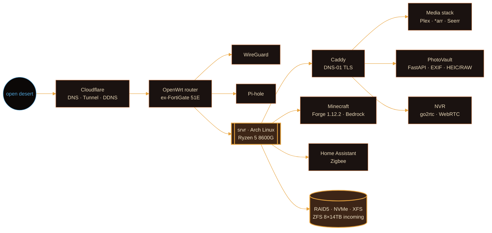

<!-- ════════════════════════════════════════════════════════════════
     TechieAndroid · deep-desert profile
     assets/*.svg are animated and theme-aware. Snake lives on the
     `output` branch, generated by .github/workflows/sandworm.yml
     ════════════════════════════════════════════════════════════════ -->

<div align="center">

<picture>
  <source media="(prefers-color-scheme: dark)"  srcset="./assets/header-dark.svg">
  <source media="(prefers-color-scheme: light)" srcset="./assets/header-light.svg">
  
</picture>

<a href="https://vflared.com">
  
</a>

<br>

<a href="https://vflared.com"></a>
<a href="https://www.linkedin.com/in/akilgore98"></a>
<a href="mailto:akilgore@vflared.com"></a>
<a href="./Austin%20Kilgore%20Resume%20Current.pdf"></a>
<a href="https://paypal.me/LinuxOwl"></a>


<sub>

[`manifest`](#-01--field-manifest) ·
[`expedition`](#-02--current-expedition) ·
[`outpost`](#-03--the-outpost) ·
[`workbench`](#-04--the-workbench) ·
[`kit`](#-05--the-kit) ·
[`artifacts`](#-06--artifacts) ·
[`ledger`](#-07--spice-ledger) ·
[`wormsign`](#-08--wormsign)

</sub>



</div>

## ◈ 01 · FIELD MANIFEST

```ini
[operator]
name        = Austin Kilgore
callsign    = TechieAndroid // vflared
station     = Ohio, USA            ; formerly the Arkansas flats
role        = Automation Engineer  ; previously Sr. Intune Engineer
terrain     = 15 years · M365 · Azure · Intune · Entra ID · Fortinet · endpoints on every OS

[doctrine]
os          = arch                 ; by choice, not by accident
shell       = fish
method      = build it from scratch, iterate until it survives production
motto       = move with the wind, never against the sand
```

> Fifteen years in the deep desert of enterprise IT. These days I automate the sand away —
> Nexthink DEX, PowerShell, and an unreasonable amount of REST. Off the clock I run a homelab
> that is more outpost than closet, and a modding bench where the capacitors are smaller than grains of sand.

<div align="center"></div>

## ◈ 02 · CURRENT EXPEDITION

| bearing | heading |
|:--|:--|
| △ **day job** | Nexthink DEX remote actions & workflows · PowerShell · API glue between everything |
| ▽ **outpost** | Migrating storage to **ZFS on 8 × 14 TB** · Grafana/Prometheus telemetry for the whole network |
| ◇ **bench** | Picofly installs across every Switch revision · KiCad board for a dual N-MOSFET driver |
| ○ **learning** |    |

<div align="center"></div>

## ◈ 03 · THE OUTPOST

<details>
<summary><b>⟢ open the map</b> — self-hosted infrastructure, built and rebuilt by hand</summary>
<br>



- Every stack is Docker Compose with **healthcheck-gated** dependencies — nothing starts until the thing it leans on is actually alive.
- Router went from FortiOS to **OpenWrt** over serial console + TFTP. The firewall is mine now.
- PhotoVault and the NVR gallery are **built from scratch**: FastAPI backends, single-file frontends, no frameworks I didn't need.

</details>

## ◈ 04 · THE WORKBENCH

<details>
<summary><b>⟢ step inside</b> — <a href="https://vflared.com">VFLARED MODDING LLC</a>, console modding & board repair</summary>
<br>

<table>
<tr>
<td width="50%" valign="top">

**services**
- Picofly modchip installs — Switch **V1 · V2 · Lite · OLED**
- Board-level SMD rework down to **0402 / 0201**
- Hot-air rework, microsoldering, diagnostics
- Write-ups and tech tips at [vflared.com](https://vflared.com)

</td>
<td width="50%" valign="top">

**bench log**
```diff
+ OLED (Aula) · modded · speedo binned
+ Erista V1 · ipatched · Samsung LPDDR4
+ dual IRFHS8342 MOSFET board · KiCad
- customer SD cards · not accepted
```

</td>
</tr>
</table>

</details>

## ◈ 05 · THE KIT

<details open>
<summary><b>⟢ unpack</b> — tools that survived the crossing</summary>
<br>

<div align="center">

**terrain** — operating systems<br>


**shelter** — infrastructure & cloud<br>


**tongue** — code<br>


**craft** — hardware, design & editors<br>


<br>


</div>

<details>
<summary><b>⟢ credentials</b> — certified crossings</summary>
<br>

| | certification |
|:--:|:--|
| ◆ | [Microsoft 365 Certified: Enterprise Administrator Expert](./Microsoft%20365%20Certified%3A%20Enterprise%20Administrator%20Expert) |
| ◆ | [Microsoft Certified: Azure Data Engineer Associate](./Microsoft%20Certified%3A%20Azure%20Data%20Engineer%20Associate) |
| ◆ | [Microsoft Certified: Azure Enterprise Data Analyst Associate](./Microsoft%20Certified%3A%20Azure%20Enterprise%20Data%20Analyst%20Associate) |

</details>
</details>

<div align="center"></div>

## ◈ 06 · ARTIFACTS

<div align="center">

<a href="https://github.com/TechieAndroid/sm64redrawn"></a>
<a href="https://github.com/TechieAndroid/dracula-themes"></a>
<a href="https://github.com/TechieAndroid/gentoo"></a>

</div>

## ◈ 07 · SPICE LEDGER

<div align="center">


<details>
<summary><b>⟢ read the wind</b> — contribution patterns</summary>
<br>

</details>

</div>

## ◈ 08 · WORMSIGN

<div align="center">

<picture>
  <source media="(prefers-color-scheme: dark)"  srcset="https://raw.githubusercontent.com/TechieAndroid/TechieAndroid/output/sandworm-dark.svg">
  <source media="(prefers-color-scheme: light)" srcset="https://raw.githubusercontent.com/TechieAndroid/TechieAndroid/output/sandworm-light.svg">
  
</picture>

<sub><i>something beneath the sand eats every commit I make. it is never full.</i></sub>


<sub><code>&gt; vflared@deep-desert:~$ exit</code> · move with the wind, never against the sand</sub>

</div>
